# AWS Terraform 3-Tier Architecture

A multi-AZ AWS 3-tier application environment provisioned using Terraform and deployed using an AWS CI/CD pipeline.
This project demonstrates Infrastructure as Code, AWS networking, load balancing, Auto Scaling, managed databases, IAM, DNS, HTTPS and automated application deployment.

## Architecture

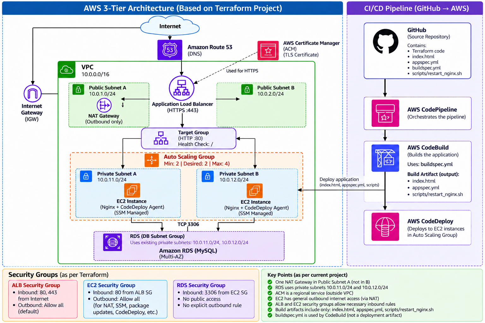

## Terraform Architecture

```
User
  |
  | HTTPS
  v
Route 53
  |
  v
Application Load Balancer
  |
  v
Target Group
  |
  +----------------------+
  |                      |
EC2                    EC2
Private Subnet A       Private Subnet B
  |                      |
  +----------+-----------+
             |
             v
          RDS MySQL
          Multi-AZ
```

## CI/CD architecture

```
Developer
   |
git push
   |
   v
GitHub
   |
   v
AWS CodePipeline
   |
   v
AWS CodeBuild
   |
   v
AWS CodeDeploy
   |
   v
EC2 Auto Scaling Group
```

## AWS Services Used

- Amazon VPC
- Public and Private Subnets
- Internet Gateway
- NAT Gateway
- Application Load Balancer
- Target Groups
- Amazon EC2
- EC2 Auto Scaling
- Launch Templates
- Amazon RDS MySQL
- Multi-AZ RDS
- IAM
- AWS Systems Manager Session Manager
- Amazon Route 53
- AWS Certificate Manager
- AWS CodePipeline
- AWS CodeBuild
- AWS CodeDeploy

## Terraform Structure

The project uses a single Terraform root module split into logical files.

```
.
├── versions.tf
├── provider.tf
├── variables.tf
├── vpc.tf
├── security-groups.tf
├── iam.tf
├── alb.tf
├── ec2-asg.tf
├── rds.tf
├── route53.tf
├── acm.tf
├── outputs.tf
├── buildspec.yml
├── appspec.yml
├── index.html
└── scripts/
```

## Networking

The VPC spans multiple Availability Zones.
The Application Load Balancer is deployed in public subnets.
EC2 instances are deployed in private subnets through an Auto Scaling Group.
Private EC2 instances use a NAT Gateway for outbound connectivity.

```
Internet
   |
Internet Gateway
   |
Public Subnets
   |
NAT Gateway
   |
Private EC2 Subnets
```

## Security

Traffic between tiers is restricted using security groups. The RDS database is not publicly accessible

```
Internet
   |
   | HTTPS 443
   v
ALB Security Group
   |
   | HTTP 80
   v
EC2 Security Group
   |
   | MySQL 3306
   v
RDS Security Group
```

## Load Balancing and Auto Scaling

The Application Load Balancer forwards traffic to a target group containing EC2 instances managed by an Auto Scaling Group.
Target health checks are configured on:

```
/
```

Auto Scaling configuration:

```
Minimum: 2
Desired: 2
Maximum: 4
```

## Database

Amazon RDS MySQL is deployed in private subnets.
The database:
- Is not publicly accessible
- Uses a DB subnet group
- Allows MySQL access only from the EC2 security group
- Uses Multi-AZ deployment for high availability

## DNS and HTTPS

Amazon Route 53 is used for DNS.
The custom domain points to the Application Load Balancer using Route 53 Alias records.
AWS Certificate Manager provides the SSL/TLS certificate. TLS terminates at the Application Load Balancer

```
http://yourdomain.com
        |
        v
ALB Port 80
        |
        | Redirect
        v
https://yourdomain.com
        |
        v
ALB Port 443
        |
        v
Target Group
        |
        v
EC2 Port 80
```

## CI/CD Pipeline

The application deployment workflow is:

```
GitHub
   ↓
CodePipeline
   ↓
CodeBuild
   ↓
CodeDeploy
   ↓
Auto Scaling EC2
```

## GitHub

A push to the ```main``` branch triggers the pipeline.

## CodeBuild

CodeBuild reads:

```
buildspec.yml
```
and prepares the deployment artifact.

## CodeDeploy

CodeDeploy reads:

```
appspec.yml
```
and deploys the application files to EC2 instances.

## Terraform Deployment

Typical Terraform workflow:

```
terraform fmt
terraform init
terraform validate
terraform plan
terraform apply
```

To remove the environment:

```
terraform destroy
```

## Troubleshooting Performed

During development I investigated:
- ALB unhealthy targets
- Security group connectivity
- Auto Scaling target registration
- IAM permissions
- CodePipeline artifact access
- CodeDeploy agent issues
- CodeDeploy deployment group configuration
- Nginx service availability
- Route 53 DNS configuration

## Skills Demonstrated

- AWS
- Terraform
- Infrastructure as Code
- VPC Networking
- EC2
- Auto Scaling
- Application Load Balancer
- RDS
- IAM
- Route 53
- HTTPS
- AWS Certificate Manager
- CodePipeline
- CodeBuild
- CodeDeploy
- Git
- GitHub
- Linux
- Nginx

## Security Notes

Sensitive information is excluded from this repository.
The following are not committed:
- AWS credentials
- Database passwords
- Terraform state files
- terraform.tfvars

## Project Evidence

### Terraform Deployment

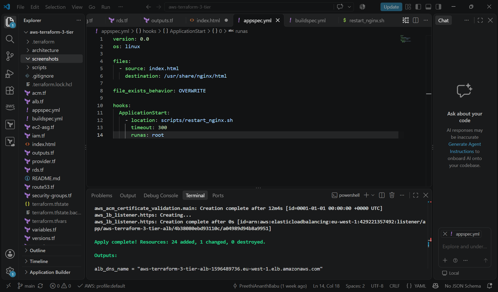

### AWS Network

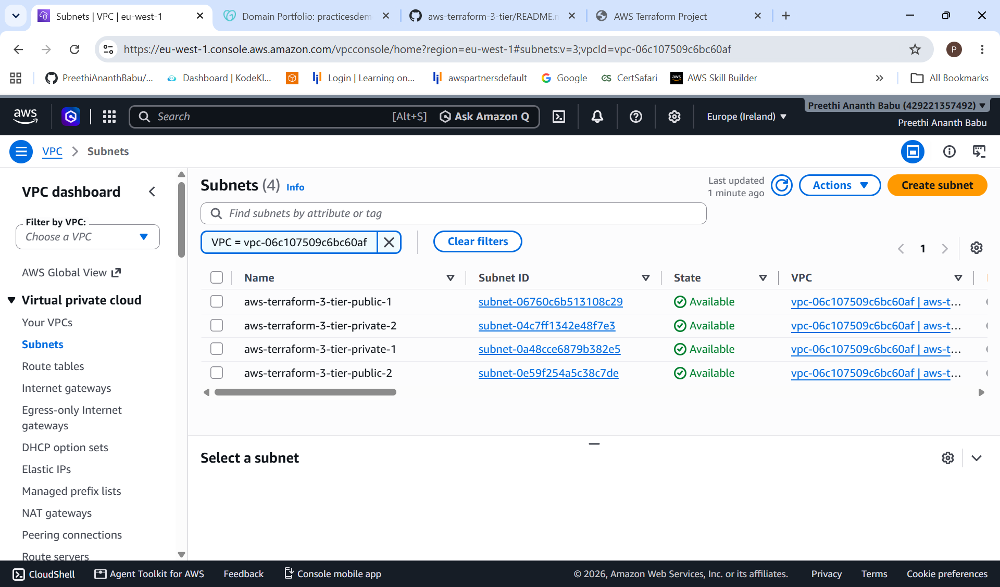

### ALB HTTPS Listeners

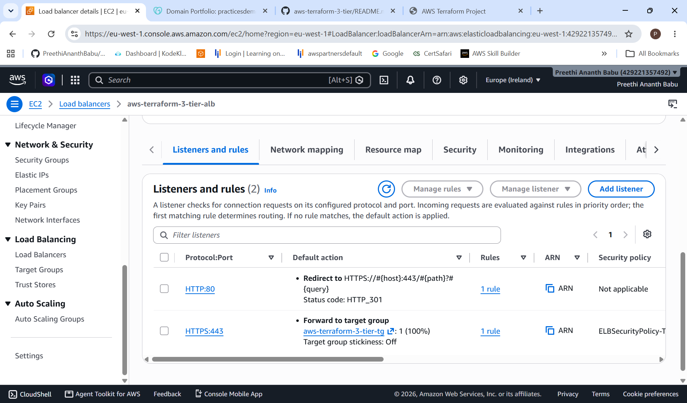

### Healthy Target Group

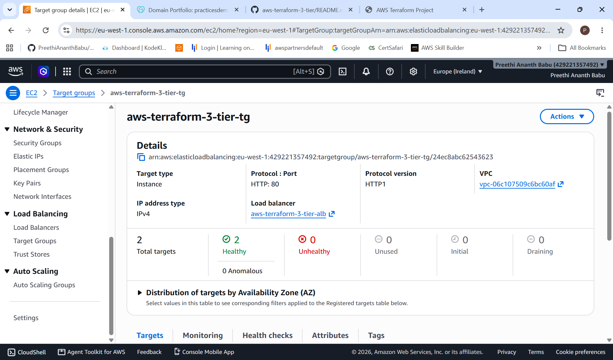

### EC2 Auto Scaling

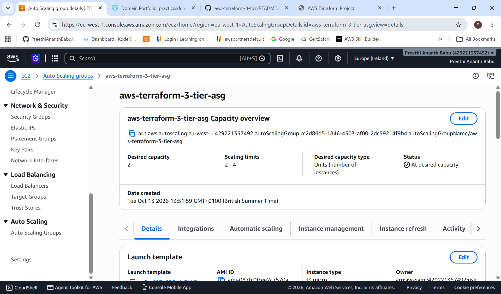

### Multi-AZ RDS

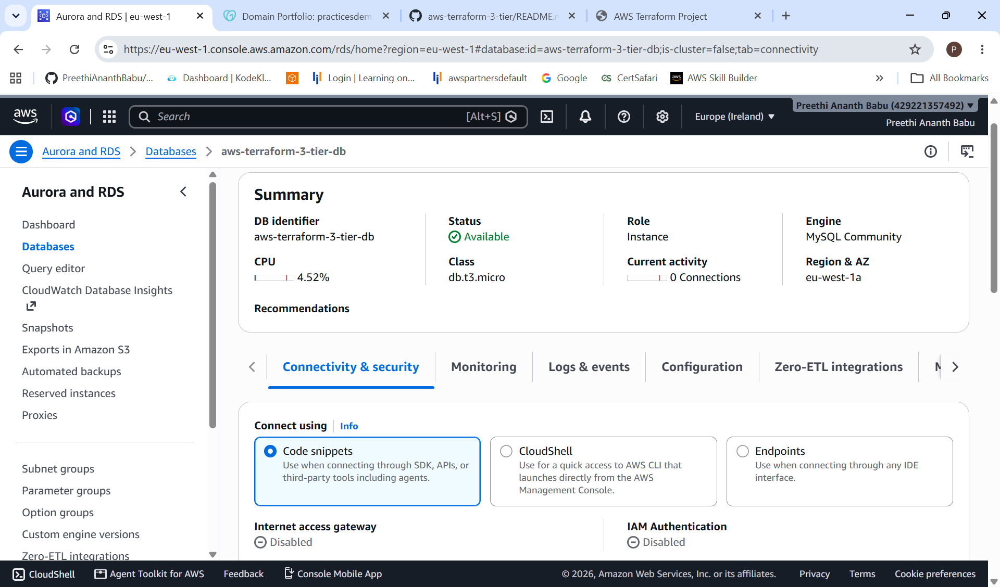

### Route 53 DNS

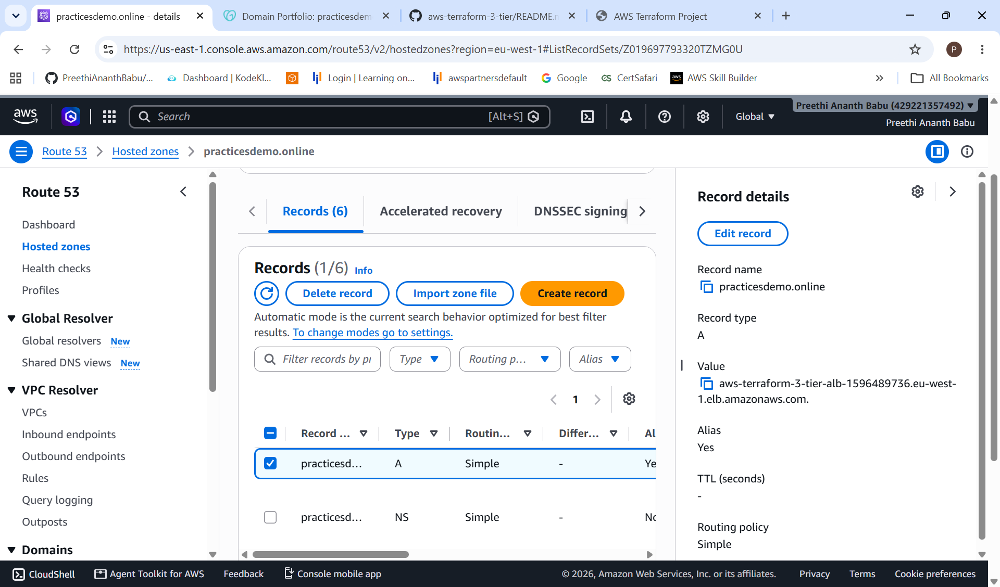

### ACM HTTPS Certificate

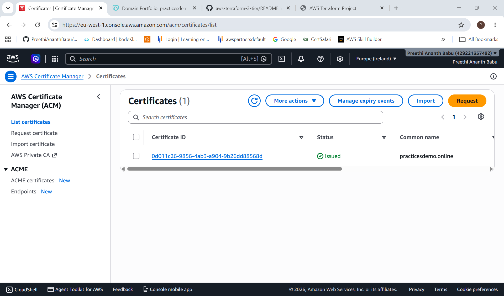

### Successful CI/CD Pipeline

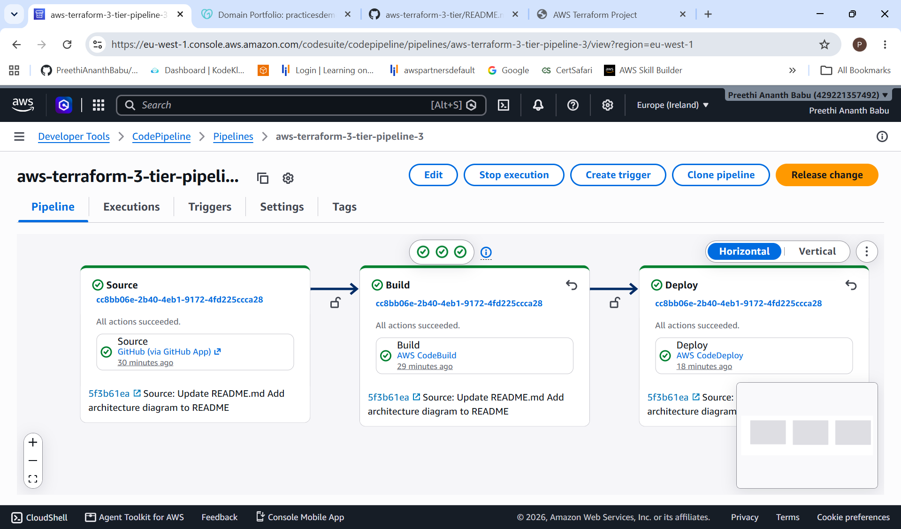

### CodeDeploy

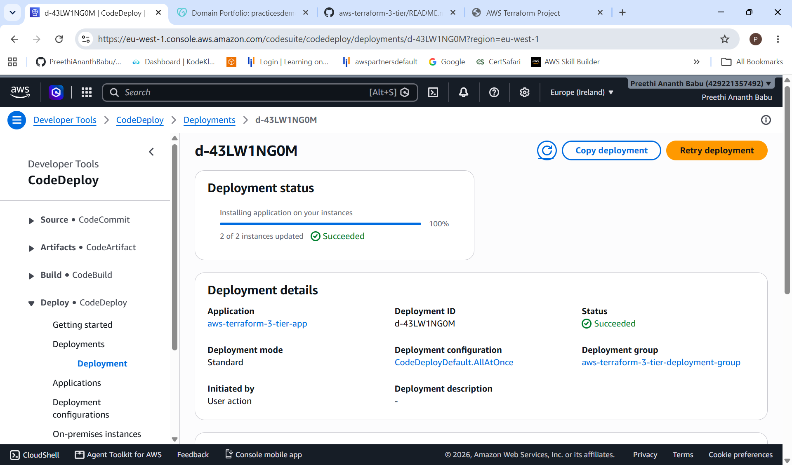

### HTTPS Application

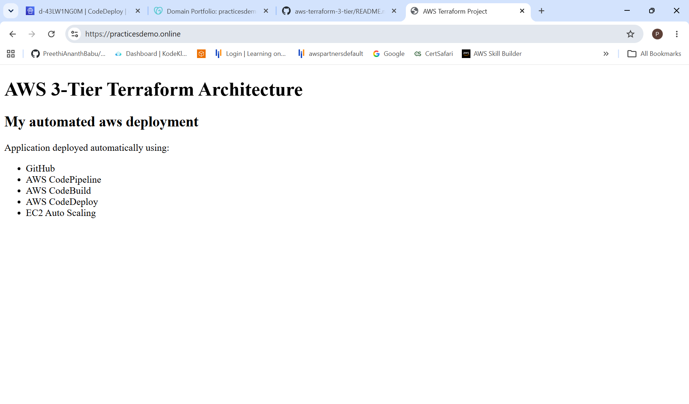
